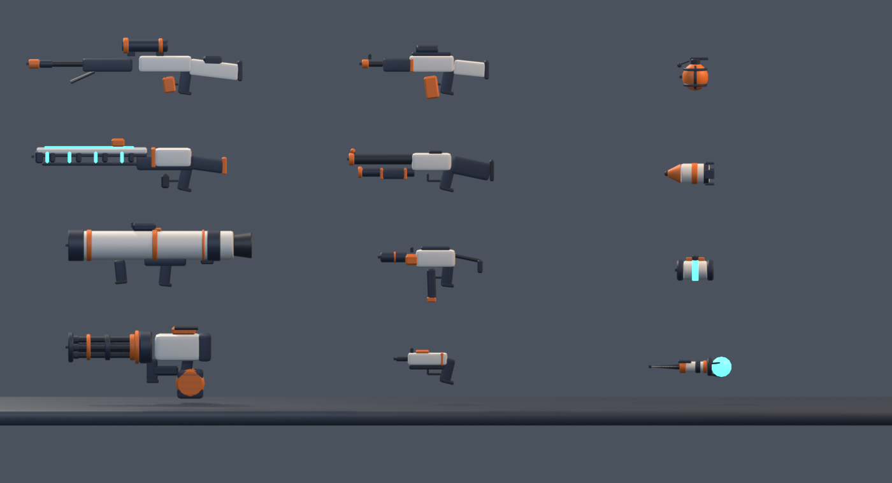
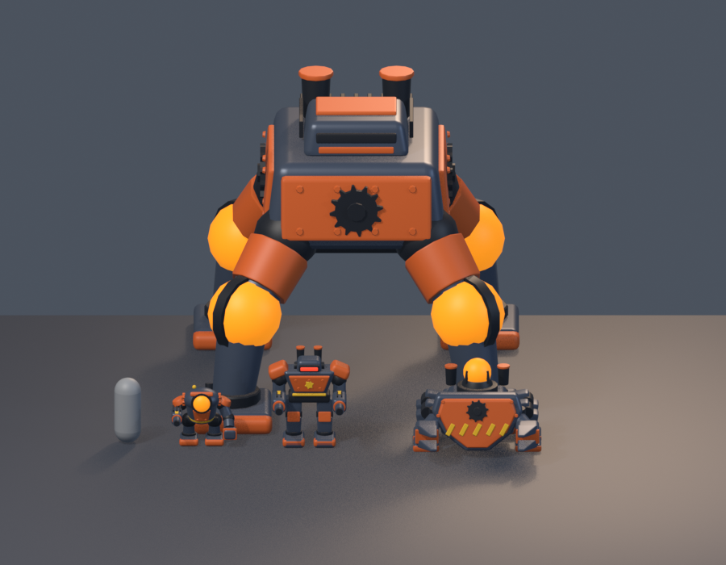
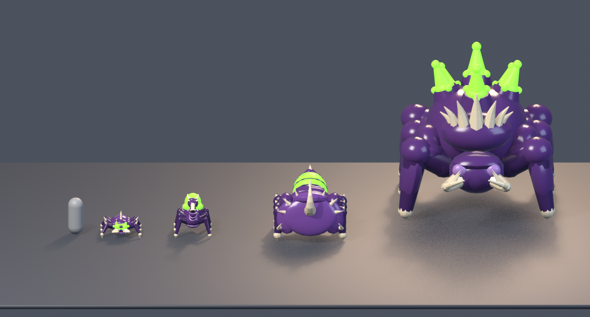

# OrbitFall

A co-op third-person squad shooter for Roblox. One to four troopers drop from the orbiting ship **ORV Halcyon** onto hostile planets, fight through objectives, call down support from orbit and hold out until the extraction skiff arrives.

PvE only: players fight AI enemies, never each other. It runs on PC, phone and gamepad.

## The game

**Core loop**

1. Gear up on the Halcyon's deck: pick a loadout and call-ins, then choose a mission on the war map.
2. Drop to the surface in capsules.
3. Complete the main objective chain, plus optional side objectives.
4. Call the skiff and hold out until it lands.
5. Board and collect XP, Salvage and Bond Tokens.
6. Spend them in the Armory and on Bonds, then go again.

A mission takes 10–18 minutes.

**Combat**
- Armour stops weak rounds. Weak spots (eyes, sacs, vents) reward precise aim.
- Enemies lose limbs: robots burst into scrap and bugs pop into goo. No blood or gore.
- Shots land with layered audio, hit-stop, camera kick and debris.
- An intensity director runs each mission through calm, build-up, breach and relax phases. Breaches arrive in waves from one direction, heavy enemies get a dramatic entrance, and extraction becomes an escalating hold-out.

**Call-ins (the Uplink Dial)**
1. Hold `Q`, or tap the satellite button or press LB.
2. Pick a slot and time the sync needle.
3. Throw the beacon. The Halcyon delivers from the sky.

Call-ins include:
- strikes: Orbital Lance, Half-Ton Bomb, Strafe Run, Orbital Barrage, Cluster Drop, Toxin Cloud, EMP Burst, Minefield;
- support: Supply Drop, Sentry Turret, Shield Dome, Smoke Screen;
- weapon drops: Rocket Tube, Gatling, Rail Lance;
- Reinforce, which brings fallen squadmates back.

**Weapons:** PR-7 Pulse Carbine, SG-4 Breacher Scatter, SM-2 Buzz SMG, MR-9 Longwatch, HS-3 Hammerhead, VR-1 Volt Repeater, the P-3 and BP-2 sidearms, and frag, impact and stun grenades.

**Enemy factions**

| Faction | Regular | Medium | Heavy | Behemoth |
|---|---|---|---|---|
| The Cogwork Legion (robots) | Tinker Drone | Rivet Trooper | Bulwark | Strider Colossus |
| The Skitter Brood (bugs) | Skitterling | Spitter | Carapace Charger | Hive Titan |
| The Lumen Concord (crystal) | Shardling | Lumen Warden | Prism Lancer | Choir Spire |

**Objectives:** Missile Launch, Uplink Relay, side objectives and set pieces, and the extraction hold-out.

**Progression:** ranks, Bonds (unlock tracks) and an Armory. There is also a galactic war map: planets across several sectors whose liberation is shared by everyone.

## Assets

Every enemy, weapon, armour piece, objective and prop is modelled from Python scripts in Blender. The full image gallery, with every asset shown as a PNG, is in **[art/README.md](art/README.md)**.





## Repository layout

```
src/                 Game code (Luau), synced into Roblox Studio with Rojo
  shared/            ReplicatedStorage.Shared: config, networking, damage, data catalogues, sounds
  server/            ServerScriptService.Server: mission flow, enemies and director, objectives,
                     call-ins, weapons, players, progression, map and ship builders
  client/            StarterPlayer.StarterPlayerScripts.Client: camera, movement, combat pose,
                     weapons, audio, effects, HUD and menus
art/                 Game assets
  blender/           Python scripts that build the models in Blender (enemies, rigs, weapons,
                     armour, environment kits, the Halcyon, set pieces)
  fbx/               Exported meshes (enemies and their rigs, weapons, props, rocks, objectives)
  textures/          Faction palette textures
  images/            PNG render of every asset (gallery: art/README.md)
  tools/             Mesh generation helpers
default.project.json Rojo project file
```

## Building and running

You need [Roblox Studio](https://create.roblox.com/) and [Rojo](https://rojo.space/) 7.x.

1. Open your place in Roblox Studio.
2. From the repo root, run:
   ```
   rojo serve default.project.json
   ```
3. In Studio, open the Rojo plugin and click **Connect**. The code syncs into the place.
4. Press Play.

To build a standalone place file instead, run `rojo build default.project.json -o OrbitFall.rbxl`. A place built this way contains only the code. Uploaded meshes, sounds and the hand-built parts of the place live in the Roblox place itself.

The meshes and sounds are referenced by Roblox asset IDs in `src/shared/Data/Meshes.luau` and `src/shared/Sounds.luau`. To rebuild a model, run its script in `art/blender/`, export the FBX and upload it through Studio.

## License

Apache 2.0. See `LICENSE`.
